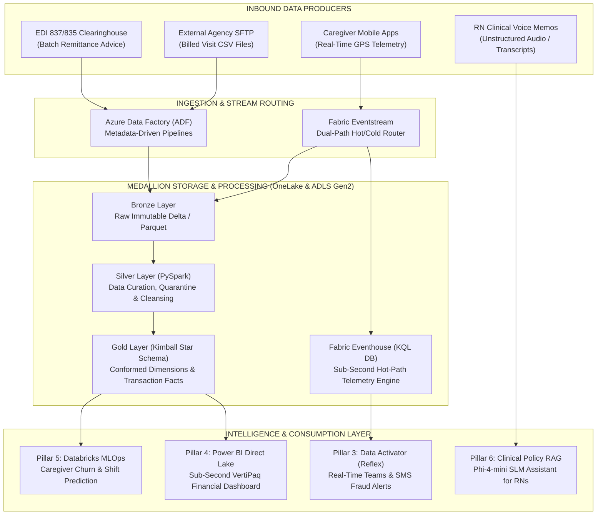

# 👨‍💻 Brijesh Chudasama | Data Engineering → Powering BI, ML & GenAI
### *Modernizing Legacy On-Premises Data Workloads into Modern Cloud Architectures using Microsoft Fabric, Azure Databricks, Azure Data Factory & Power BI*

 

 

-0078D4?style=for-the-badge&logo=data%3Aimage/svg%2Bxml%3Bbase64%2CPHN2ZyB4bWxucz0iaHR0cDovL3d3dy53My5vcmcvMjAwMC9zdmciIHZpZXdCb3g9IjAgMCAyNCAyNCI%2BPHBhdGggZmlsbD0id2hpdGUiIGQ9Ik03IDJ2MTFoM3Y5bDctMTJoLTRsNC04SDd6Ii8%2BPC9zdmc%2B)

---

## 👤 About Me

I am an **Azure Data Engineer** with a strong background in large-scale relational database systems, high-throughput enterprise ETL pipelines, and cloud lakehouse modernization:

* **Enterprise Roots:** Proven engineering experience at an **Enterprise Healthcare SaaS & Home Care Technology Platform** designing, operating, and modernizing mission-critical healthcare ingestion pipelines (HIPAA EDI 837/835 transactions, Relational Database Staging, Secure SFTP/MFT) reconciling **50+ million annual visits** for State Medicaid and Managed Care Payers.
* **Modern Cloud Focus:** Specializing in migrating legacy on-premises ETL workloads into the **modern Azure Cloud Lakehouse stack (Azure Data Factory, Azure Databricks Serverless, Delta Lake, Microsoft Fabric OneLake, and Synapse Analytics)**.
* **Full-Lifecycle Capabilities:** Experienced across the entire data engineering lifecycle:
  - **Medallion Architecture:** Raw $\rightarrow$ Bronze $\rightarrow$ Silver $\rightarrow$ Gold dimensional modeling (Kimball Star Schemas, SCD Type 1 & 2).
  - **Distributed Computing:** PySpark optimizations, data skew mitigation, Delta Lake ACID transactions (`MERGE INTO`), and Z-ORDER / V-ORDER file clustering.
  - **Real-Time Streaming:** Fabric Eventstream, KQL Eventhouse, sub-second geospatial fraud detection, and automated event push alerting.
  - **Zero-Copy BI:** Direct Lake Semantic Modeling on OneLake Parquet files, eliminating traditional data import delays and database query bottlenecks.
  - **Cloud MLOps & GenAI:** Automated batch model inference with MLflow & Delta Feature Stores, and serverless SLM retrieval-augmented generation (RAG).

---

## 🏛️ The 6-Pillar Enterprise Healthcare Data & AI Ecosystem

Below is a fully architected, production-grade cloud platform demonstrating end-to-end data modernization across Healthcare Revenue Cycle Management (RCM), Fraud Prevention, and Operations:

| Pillar | Focus Area | Core Technologies | Live Repository | Key Engineering Highlights |
| :---: | :--- | :--- | :--- | :--- |
| **1** | **Azure PaaS Batch Lakehouse** | ADF, Azure Databricks, ADLS Gen2, Delta Lake, Synapse | [**`azure-homecare-edi-modernization`**](https://github.com/brijesh-chudasama/azure-homecare-edi-modernization) | Migrated legacy on-prem ETL pipelines into metadata-driven ADF pipelines + PySpark Medallion Lakehouse; Kimball Star Schema. |
| **2** | **Fabric SaaS Lakehouse & SCD2** | Microsoft Fabric Spark, OneLake, PySpark, SCD Type 2 | [**`fabric-medicaid-claims-lakehouse`**](https://github.com/brijesh-chudasama/fabric-medicaid-claims-lakehouse) | Ingests 5,000+ EDI 835 remittances; matches billed visits; isolates CARC denials; maintains SCD Type 2 audit ledger. |
| **3** | **Real-Time Intelligence (RTI)** | Fabric Eventstream, KQL Eventhouse, Data Activator | [**`fabric-realtime-evv-platform`**](https://github.com/brijesh-chudasama/fabric-realtime-evv-platform) | Sub-second EVV GPS fraud detection (`geo_distance_2points > 500m`); real-time coordinator push alerts on missed shifts. |
| **4** | **Enterprise BI & Direct Lake** | Fabric Direct Lake Mode, Power BI VertiPaq, DAX | [**`powerbi-homecare-rcm-command-center`**](https://github.com/brijesh-chudasama/powerbi-homecare-rcm-command-center) | Zero-copy direct querying of OneLake Parquet tables; executive DAX metrics: Clean Claim Rate %, A/R Aging (0-90+ days). |
| **5** | **MLOps Shift Churn Engine** | Databricks Serverless, MLflow, Delta Feature Store | [**`databricks-caregiver-retention-mlops`**](https://github.com/brijesh-chudasama/databricks-caregiver-retention-mlops) | Proactive shift no-show & caregiver burnout prediction; point-in-time correct Delta features; registered MLflow model. |
| **6** | **Clinical Policy GenAI (RAG)** | Azure AI Foundry SLM (Phi-4-mini), ChromaDB, Streamlit | [**`azure-ai-medicaid-policy-rag`**](https://github.com/brijesh-chudasama/azure-ai-medicaid-policy-rag) | Clinical RN voice copilot; HIPAA PHI sanitization; vector similarity search for Medicaid prior authorization compliance. |

---

## 🗺️ Master Architecture: Top-to-Bottom Enterprise Flow

---

## 🛠️ Technical Competencies & Tool Matrix

| Category | Enterprise Technologies |
| :--- | :--- |
| **Cloud Platforms** | Microsoft Azure (ADLS Gen2, Azure Data Factory, Synapse Analytics, Key Vault, IAM), Microsoft Fabric (OneLake, Direct Lake, RTI). |
| **Distributed Data Processing** | Azure Databricks (Serverless Compute, PySpark, Spark SQL, Delta Lake, Unity Catalog, Repos). |
| **ETL & Data Pipelines** | Azure Data Factory (Pipelines, Copy Activities, Webhooks, Parameterization), SSIS (SQL Server Integration Services), Secure SFTP / MFT Ingestion. |
| **Data Modeling & Storage** | Kimball Star / Snowflake Schemas, Slowly Changing Dimensions (SCD Type 1 & 2), Delta Lake (`MERGE INTO`, Time Travel, Z-ORDER, V-ORDER). |
| **Real-Time & Streaming** | Fabric Eventstream, Fabric Eventhouse, KQL (Kusto Query Language), Data Activator (Reflex), Azure Event Hubs. |
| **Business Intelligence** | Power BI Desktop & Service, Direct Lake Mode, VertiPaq Engine, Tabular Modeling (TMDL/BIM), Advanced DAX, Tabular Editor. |
| **MLOps & Generative AI** | MLflow (Tracking & Model Registry), Delta Lake Feature Store, LightGBM, Azure AI Foundry Serverless SLM (Phi-4-mini), ChromaDB, LangChain. |
| **Languages & Tooling** | Python, PySpark, T-SQL, DAX, KQL, Git/GitHub, PowerShell, Docker, Postman. |

---

## 📈 Proven Enterprise Impact & Engineering Metrics

* ⚡ **Zero-Copy Direct Lake Optimization:** Cut dashboard load latency from 45-minute batch imports down to **sub-second (<0.3s) Direct Lake** queries directly on OneLake Gold Parquet files.
* 🛡️ **Sub-Second Fraud Mitigation:** Designed real-time KQL geospatial distance calculations (`geo_distance_2points > 500m`) detecting caregiver ghost clock-ins before billing submission.
* 🔄 **SCD Type 2 Audit Traceability:** Implemented automated versioning (`effective_date`, `end_date`, `is_current`) across 4,400+ claim transitions to guarantee 100% Medicaid audit compliance.
* 💰 **FinOps Zero-Cost Guardrails:** Enforced strict architectural cost policies utilizing Azure Serverless auto-pause compute, resulting in **$0 idle cloud spend**.

---

 

 

-0078D4?style=for-the-badge&logo=data%3Aimage/svg%2Bxml%3Bbase64%2CPHN2ZyB4bWxucz0iaHR0cDovL3d3dy53My5vcmcvMjAwMC9zdmciIHZpZXdCb3g9IjAgMCAyNCAyNCI%2BPHBhdGggZmlsbD0id2hpdGUiIGQ9Ik03IDJ2MTFoM3Y5bDctMTJoLTRsNC04SDd6Ii8%2BPC9zdmc%2B)

